# 4. Распознавание тестовых цепочек методом CYK

## 4.1. Распознавание цепочек в JFLAP

Итоговая НФХ-грамматика проверена в штатном окне CYK Parse системы JFLAP 7.1. 
На каждом снимке интерфейса видны введенная цепочка, сообщение JFLAP String is 
Accepted! или String is Rejected! и таблица продукций. В таблице ниже приведены семь 
корректных и пять некорректных цепочек.

### Тестовые цепочки

Для проверки грамматики выбраны следующие цепочки:

| **№** | **Цепочка**  | **Результат** | **Обоснование**                                                  |
| ----- | ------------ | ------------- | ---------------------------------------------------------------- |
| 1     | `a=1`        | Accept        | Допустимая переменная и двоичная константа                       |
| 2     | `b=10+1`     | Accept        | Сложение двоичных констант                                       |
| 3     | `c=a+b*10`   | Accept        | Сложение и умножение с учетом приоритета операций                |
| 4     | `d=-(a+1)`   | Accept        | Унарный минус и выражение в скобках                              |
| 5     | `e=a/b`      | Accept        | Деление допустимых переменных                                    |
| 6     | `f=1-0/1`    | Accept        | Вычитание и деление двоичных констант                            |
| 7     | `a=(b-c)*10` | Accept        | Выражение в скобках и умножение                                  |
| 8     | `g=1`        | Reject        | Переменная `g` находится вне допустимого диапазона `a`–`f`       |
| 9     | `a=2`        | Reject        | Цифра `2` не входит в алфавит двоичных констант                  |
| 10    | `a=1+`       | Reject        | Отсутствует правый операнд после сложения                        |
| 11    | `a=(1+0`     | Reject        | Отсутствует закрывающая скобка                                   |
| 12    | `a=1**0`     | Reject        | Два оператора умножения записаны подряд                          |

### Цепочки, принадлежащие языку

**1.** `a=1`

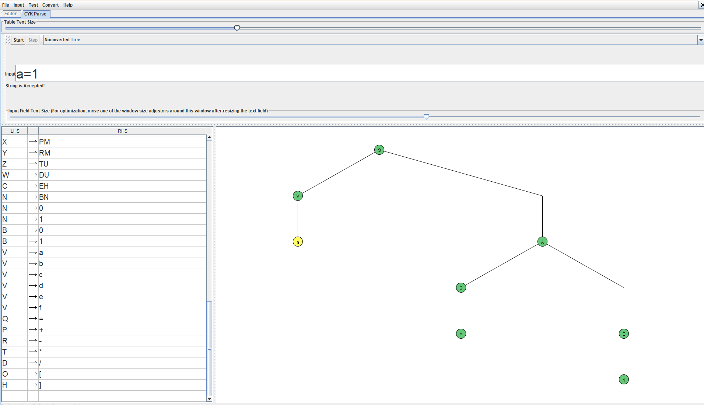

**2.** `b=10+1`

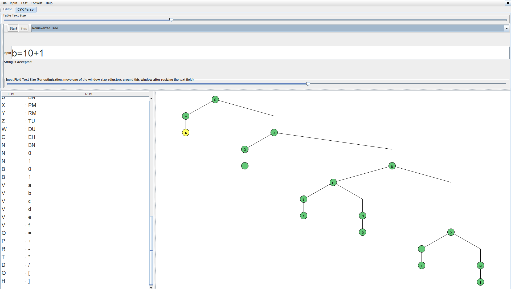

**3.** `c=a+b*10`

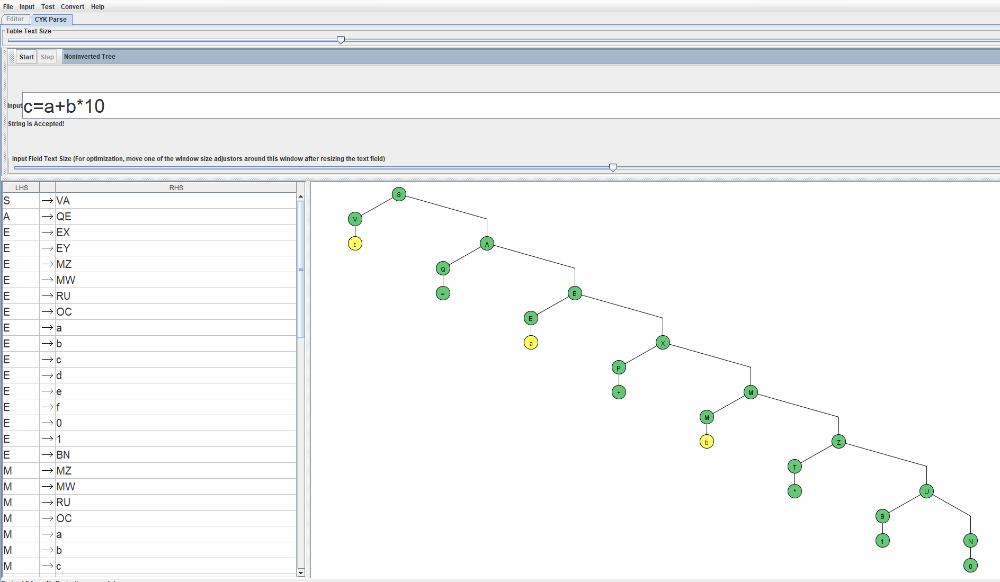

**4.** `d=-(a+1)`

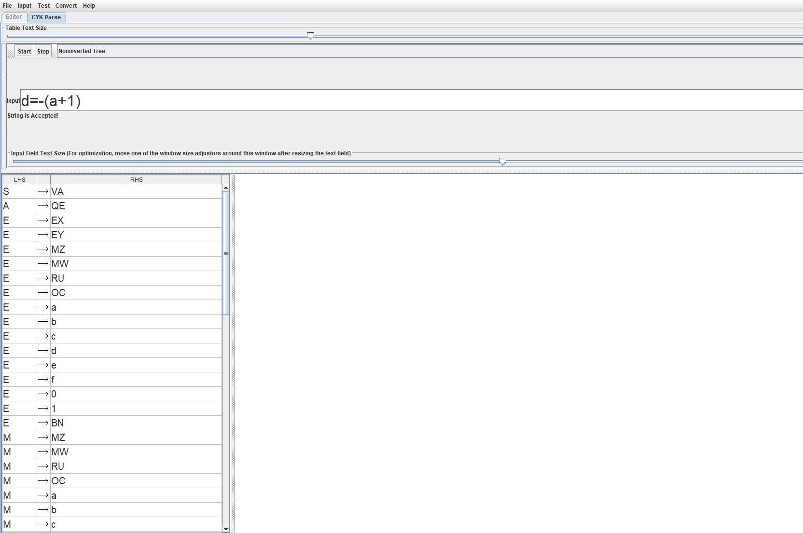

**5.** `e=a/b`

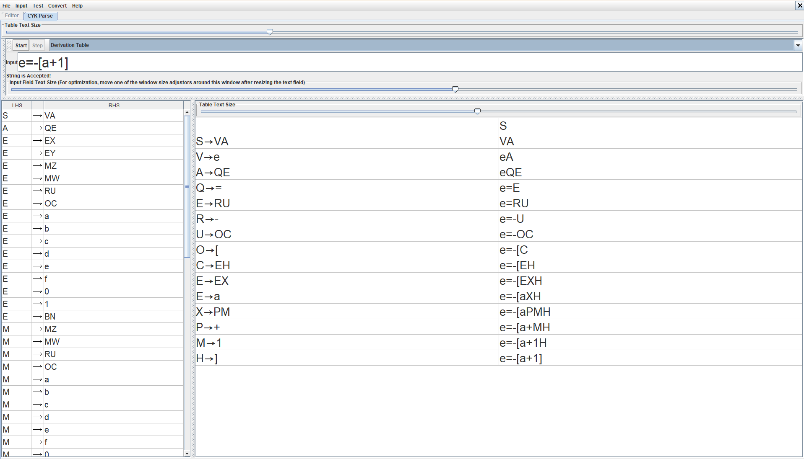

**6.** `f=1-0/1`

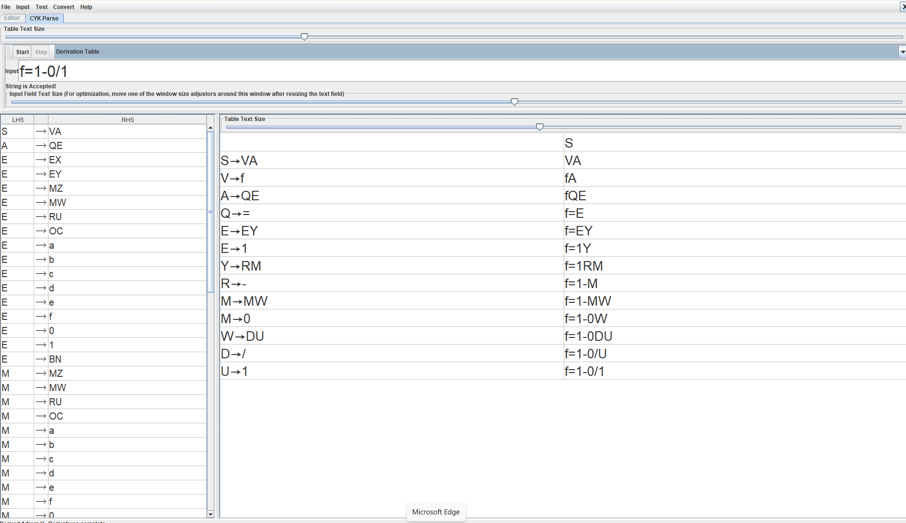

**7.** `a=(b+c)*10`

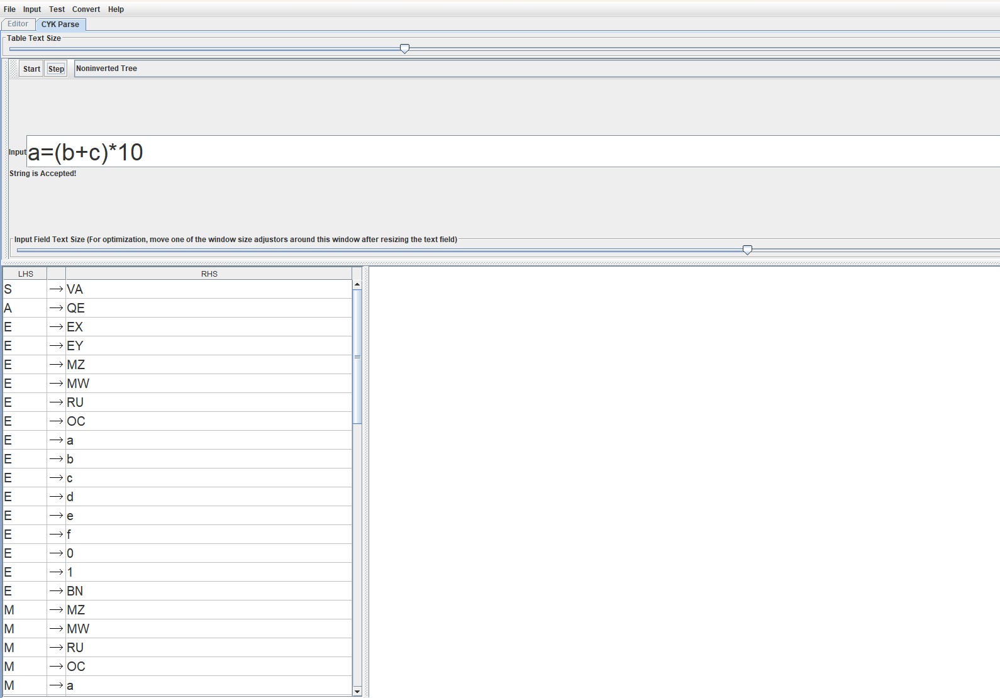

### Цепочки, не принадлежащие языку

**8.** `g=1`

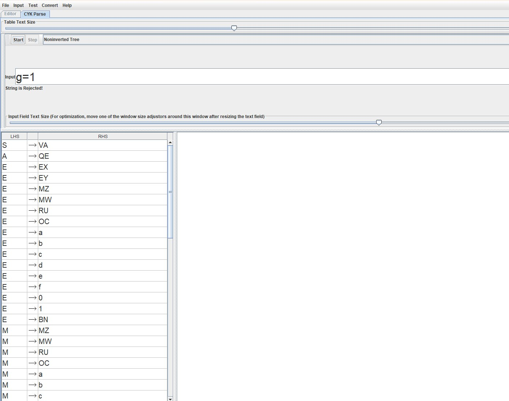

**9.** `a=2`

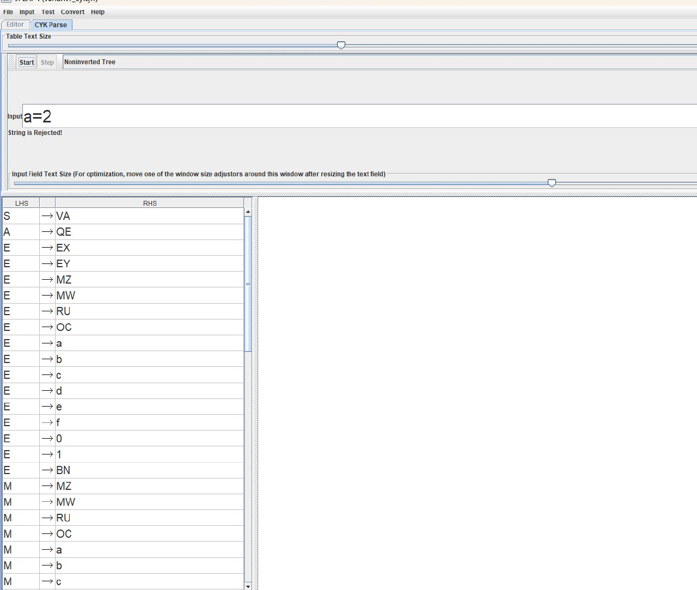

**10.** `a=1+`

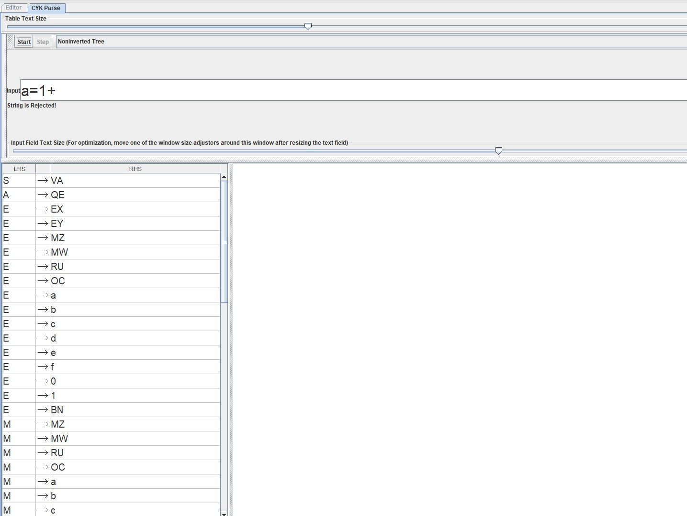

**11.** `a=(1+0`

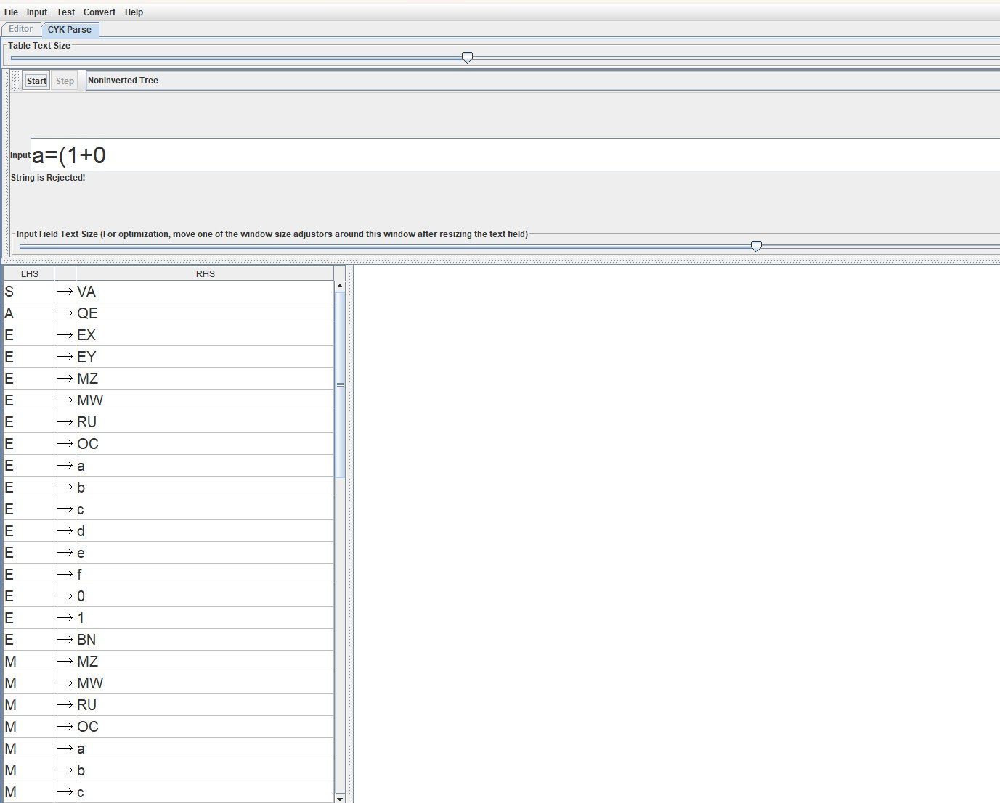

**12.** `a=1**0`

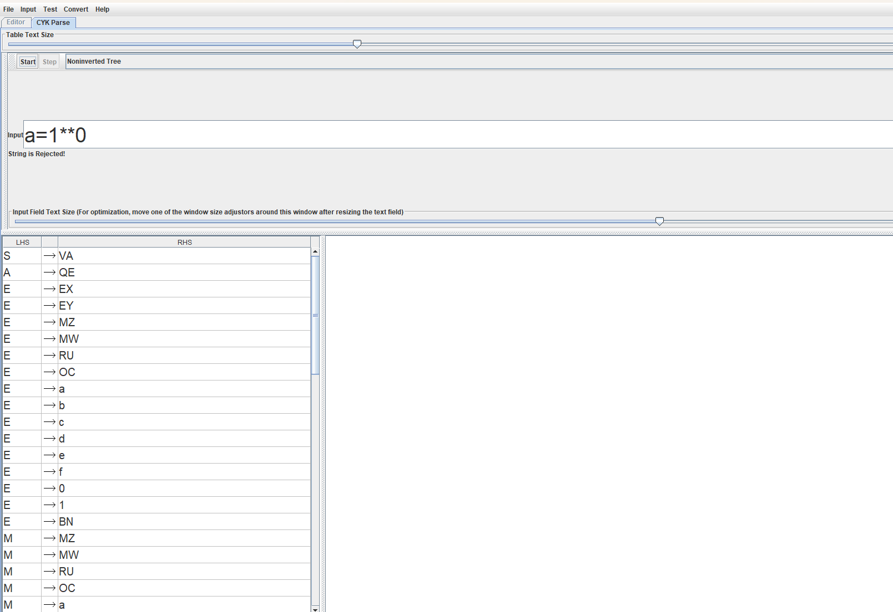

## 4.2. Программная реализация алгоритма CYK

Дополнительно алгоритм CYK реализован на языке Python.

Программа использует построенную контекстно-свободную грамматику в нормальной форме Хомского. Для каждой входной цепочки формируется таблица, в ячейки которой заносятся нетерминалы, способные породить соответствующие подстроки.

Если начальный символ `S` присутствует в ячейке, соответствующей всей входной строке, цепочка принимается. В противном случае цепочка отклоняется.

Исходный код и вывод программы:

[Код программы](./practice4.py)

[Вывод результатов](./results.txt)

